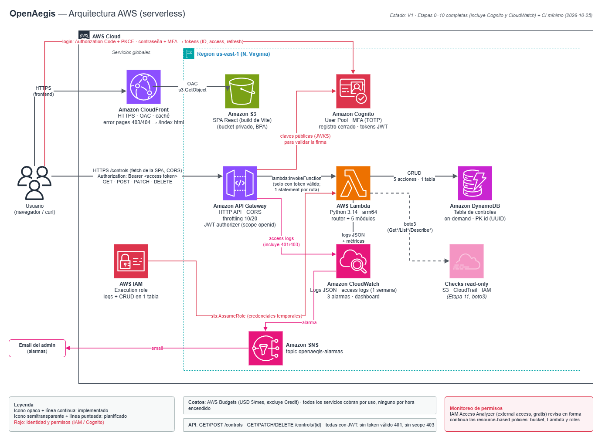
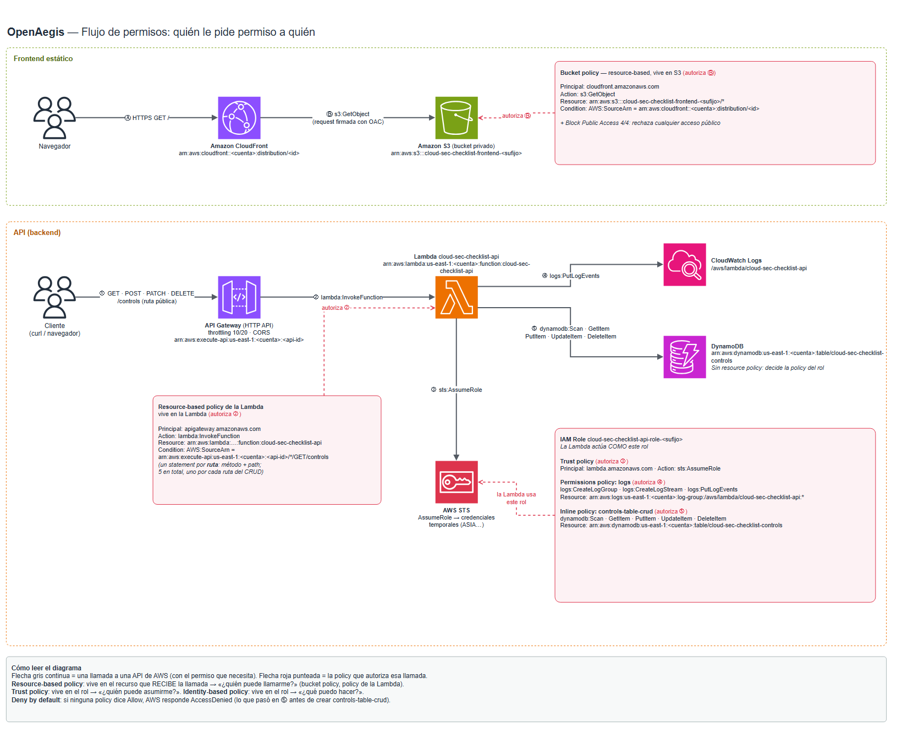

# OpenAegis

> Aplicación serverless en AWS para gestionar controles de seguridad cloud y, más adelante, evaluarlos con checks automáticos de solo lectura.
> Proyecto **educativo y de portfolio**, construido etapa por etapa para entender cada servicio de AWS que usa. *(Antes: "Cloud Security Checklist".)*

**Estado:** V1 en desarrollo. Etapas 0–7 completas (CRUD de controles funcionando y permisos auditados); sigue la Etapa 8 (frontend). Ver [Roadmap](#roadmap).

---

## Qué es

Un **control** es una regla de seguridad que debería cumplirse en una cuenta de AWS, por ejemplo *"S3 Block Public Access activado"*, *"CloudTrail habilitado"* o *"MFA en el root"*. OpenAegis permite registrar esos controles con su severidad y su estado (`PASS` / `REVIEW` / `FAIL`) mediante una API REST.

En las próximas etapas va a ejecutar **checks automáticos de solo lectura** con boto3 sobre la propia cuenta, para generar **findings** (el resultado de evaluar un control sobre un recurso concreto), un score y un dashboard.

**Lo que no es:** no es un scanner de seguridad completo ni compite con Prowler, ScoutSuite, Wiz o Prisma Cloud. **No garantiza la seguridad de una cuenta.** Su objetivo es aprender y poder explicar cada decisión de arquitectura, seguridad y costos.

## Qué funciona hoy

| Funcionalidad | Estado |
|---|---|
| Frontend estático servido por CloudFront desde un bucket S3 privado | ✅ Solo una página de prueba |
| API HTTP con throttling y CORS restringido | ✅ |
| `GET /controls` — listar controles | ✅ |
| `GET /controls/{id}` — obtener un control | ✅ |
| `POST /controls` — crear un control (validación de tipos, largos, enums, `code` único, allowlist de campos) | ✅ |
| `PATCH /controls/{id}` — editar campos o cambiar el estado (404 sin crear items, 409 por `code` de otro control, allowlist) | ✅ |
| `DELETE /controls/{id}` — eliminar un control (404 si no existe, devuelve el item borrado) | ✅ |
| Frontend real, autenticación, checks, findings, score, IaC, CI, tests automatizados | 🔜 Ver roadmap |

## Arquitectura

```text
Navegador ──HTTPS──► CloudFront ──OAC──► S3 (privado)                   frontend estático

Cliente ──HTTPS──► API Gateway (HTTP API) ──► Lambda (Python) ──► DynamoDB
                    throttling + CORS            │
                                                 └──► CloudWatch Logs
```

Todo corre en una sola cuenta y en una sola región (`us-east-1`). Detalle completo (recursos, permisos, flujo de una request, modelo de datos): **[docs/ARCHITECTURE.md](docs/ARCHITECTURE.md)**.



**Quién le pide permiso a quién** (policies de cada flecha):



*Los dos diagramas son PNG editables con la extensión draw.io de VS Code (llevan el XML embebido).*

### Backend

Python puro, sin frameworks ni dependencias externas, separado por responsabilidad:

| Archivo | Responsabilidad |
|---|---|
| `handler.py` | Router: `routeKey` → función |
| `controls.py` | Reglas de negocio y status codes |
| `validation.py` | Qué es un control válido (sin AWS ni HTTP) |
| `repository.py` | Único módulo que habla con DynamoDB |
| `responses.py` | Formato de respuesta de API Gateway |

## Por qué esta arquitectura

Cada decisión está registrada con su motivo y sus alternativas en **[docs/DECISIONS.md](docs/DECISIONS.md)**; las cinco más importantes tienen un ADR completo en **[docs/architecture-decisions/](docs/architecture-decisions/)**.

### Por qué serverless

| A favor | En contra |
|---|---|
| Tráfico bajo e irregular: se paga por uso, no por hora | **Cold starts** (el Init también se factura) |
| No hay servidores ni sistema operativo que parchar | Límites de ejecución (duración, memoria, payload) |
| Alta disponibilidad multi-AZ sin configurarla | Debugging distinto: logs distribuidos en streams, sin un servidor al que conectarse |
| Escala automáticamente | Con tráfico alto y constante puede salir más caro que un container |
| Poca infraestructura que operar: adecuada para aprender | El empaquetado de dependencias nativas (p. ej. arm64) se complica |

**Serverless no significa automáticamente "más barato" ni "mejor".** Fue la opción adecuada para el tamaño y los objetivos de esta etapa. Una comparación explícita Lambda vs. containers está planificada para después de la V1.

### Por qué S3 + CloudFront para el frontend

HTTPS incluido, bucket **privado** (solo CloudFront puede leerlo, mediante OAC) y caché en el edge. El *static website hosting* de S3 obligaría a hacer público el bucket. Desventajas: hay que invalidar la caché después de cada cambio y agrega una pieza más que entender.

### Por qué API Gateway HTTP API

Punto de entrada HTTP con **throttling** (techo de costo mientras la API no tiene autenticación), CORS gestionado y autorizador JWT nativo para Cognito, más barato que una REST API. Desventaja: menos funcionalidades que la REST API (por ejemplo, sin WAF directo ni API keys).

### Por qué DynamoDB

Serverless, pago por uso y acceso **por IAM**: no hay usuario y contraseña de base de datos que guardar. Las consultas de la app son simples y conocidas (uno por id o todos). Desventajas: sin joins, una consulta nueva puede requerir un índice, y los reportes tipo `GROUP BY` se resuelven en el código. RDS se descartó porque cobra por hora encendido.

## Deployment model

**Self-hosted, single-account.** Cada persona despliega su propia copia en **su** cuenta de AWS, y la app evalúa **esa misma cuenta**. Los controles y findings **no salen de esa cuenta**, y cada uno paga su propio consumo. Los permisos de los checks van a ser de solo lectura y se podrán revisar antes de desplegar.

⚠️ **Hoy todavía no es reproducible:** la infraestructura se creó a mano en la consola, como parte del aprendizaje. El despliegue con un comando (`cdk deploy`) llega en la Etapa 12 (AWS CDK en Python).

## Seguridad

- **Least privilege:** el rol de la Lambda solo puede hacer `Scan`, `GetItem`, `PutItem`, `UpdateItem` y `DeleteItem` sobre **una** tabla. API Gateway solo puede invocar la Lambda desde esta API y desde paths concretos. CloudFront es el único que puede leer el bucket.
- **Sin credenciales de larga duración:** sin access keys; la CLI se usa desde AWS CloudShell. Root con MFA y sin uso diario.
- **Validación estricta** de la entrada: tipos, largos, valores permitidos y allowlist de campos (protección contra *mass assignment*). Escrituras condicionales para no pisar ni crear items por accidente.
- **CORS** restringido al dominio del frontend (aclaración: CORS **no** es autenticación; la autenticación llega con Cognito).
- **Throttling** en la API para limitar el abuso y el costo (*denial of wallet*).
- **Logs** con ruta e IDs de request, **sin** el event completo (que incluye headers e IP).
- Pendiente: autenticación (Cognito), alarmas, revisión completa de IAM.

## Costos

La cuenta usa el **AWS Free plan**, con un Budget mensual que excluye los créditos y alertas de Free Tier. Todos los servicios usados cobran por uso; con tráfico de prueba, el consumo es de fracciones de centavo. Se evitaron deliberadamente los servicios que cobran por hora aunque no se usen (EC2, RDS, NAT Gateway, load balancers) y opciones con costo fijo (WAF, PITR, KMS propio). Precios y riesgos de cada servicio, verificados en la documentación oficial al momento de cada etapa, en los docs de [docs/](docs/). **Verificar siempre los precios vigentes antes de desplegar.**

## Probarlo

Mientras no exista IaC, el despliegue del código es manual:

```powershell
Compress-Archive -Path backend\*.py -DestinationPath lambda.zip -Force   # luego: Lambda → Upload from .zip
```

```bash
curl -i https://<api-id>.execute-api.us-east-1.amazonaws.com/controls
```

Procedimiento completo: [AGENTS.md §7](AGENTS.md#7-cómo-desplegar-y-probar-solo-lo-verificado).

## Destrucción

Cada doc de etapa tiene su sección **"Cómo revertir esta etapa"**. Orden sugerido para eliminar todo, de lo más dependiente a lo menos: rutas y API → statements de la resource-based policy de la Lambda → Lambda y su log group → rol de ejecución → tabla DynamoDB → distribución de CloudFront (deshabilitar y luego borrar) → bucket S3 (vaciar y luego borrar) → verificar por el tag `Project`. Con CDK (Etapa 12) esto pasa a ser `cdk destroy` + verificación.

## Roadmap

**V1 (en curso):** cuenta segura → S3 → CloudFront → Lambda → API Gateway → DynamoDB → IAM → **frontend (siguiente)** → Cognito → CloudWatch → checks read-only + findings + score → CDK → CI → tests → documentación → demo.

**Después de la V1:** una revisión de arquitectura V1 → V2 y una evolución progresiva hacia Cloud/DevSecOps (containers, Terraform, CI/CD con OIDC, observabilidad, remediación controlada). Cada tecnología se agrega solo si resuelve un problema concreto.

Detalle: [docs/ROADMAP.md](docs/ROADMAP.md).

## Documentación

| Doc | Contenido |
|---|---|
| [docs/00](docs/00-account-setup.md) … [docs/07](docs/07-iam.md) | Una etapa por documento: conceptos, decisiones, configuración, verificación, costos, cómo revertir |
| [docs/ARCHITECTURE.md](docs/ARCHITECTURE.md) | Arquitectura implementada |
| [docs/DECISIONS.md](docs/DECISIONS.md) | Todas las decisiones técnicas (índice) |
| [docs/architecture-decisions/](docs/architecture-decisions/) | ADRs de las decisiones grandes: serverless, S3 + CloudFront, HTTP API, DynamoDB, modelo de despliegue |
| [docs/ROADMAP.md](docs/ROADMAP.md) | Etapas y estado |
| [docs/LEARNING_LOG.md](docs/LEARNING_LOG.md) | Conceptos aprendidos y errores encontrados |
| [docs/PROJECT_CONTEXT.md](docs/PROJECT_CONTEXT.md) | Origen y objetivos del proyecto |

## Licencia

[MIT](LICENSE)
